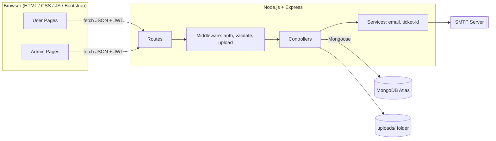
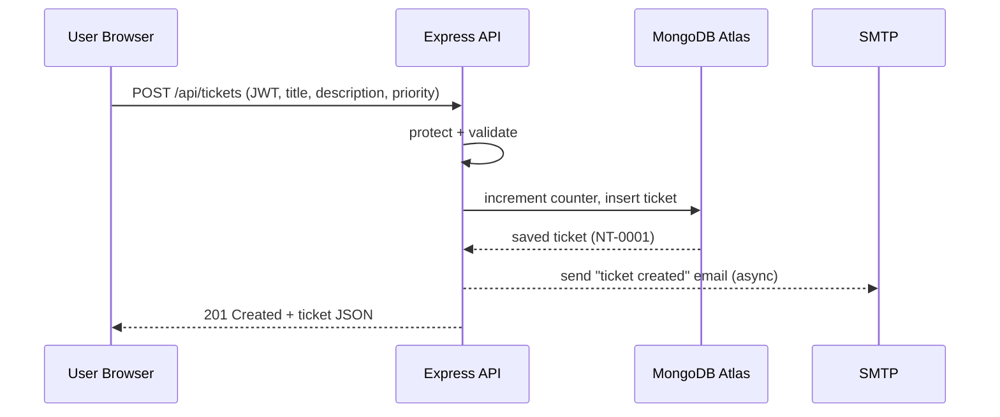
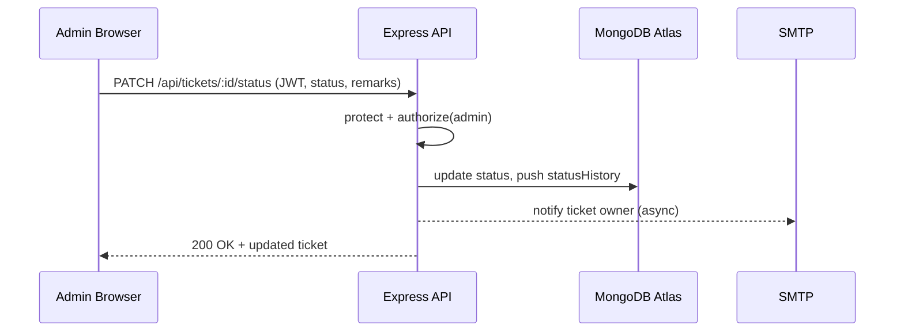
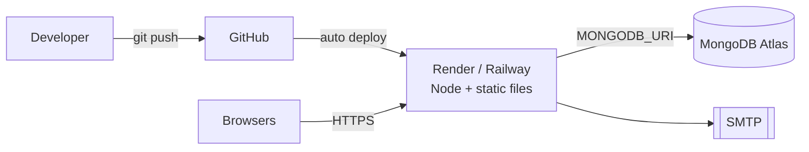

# System Architecture
## Nettech Help Desk Ticket Management System

## 1. High-Level Architecture
Three-tier architecture: **Presentation → Application (REST API) → Data**.



## 2. Request Flow (Raise Ticket)


## 3. Admin Status Update Flow


## 4. Layers & Responsibilities
| Layer | Responsibility |
|---|---|
| **Views (public/)** | Static HTML pages, Bootstrap layout, JS calls the API with `fetch`. |
| **Routes** | Map URL + method to controller; attach middleware. |
| **Middleware** | JWT verification, role checks, validation, uploads, errors. |
| **Controllers** | Handle request/response and business rules. |
| **Models** | Mongoose schemas for User, Ticket, Counter. |
| **Services/Utils** | Email sender, ticket-ID generator, token helper. |
| **Config** | DB connection, env loading. |

## 5. Folder Structure
```
nettech-helpdesk/
├── server.js
├── package.json
├── .env                    # never commit
├── .env.example
├── .gitignore
├── config/
│   └── db.js
├── models/
│   ├── User.js
│   ├── Ticket.js
│   └── Counter.js
├── controllers/
│   ├── authController.js
│   ├── userController.js
│   ├── ticketController.js
│   └── dashboardController.js
├── routes/
│   ├── authRoutes.js
│   ├── userRoutes.js
│   ├── ticketRoutes.js
│   └── dashboardRoutes.js
├── middleware/
│   ├── auth.js             # protect, authorize
│   ├── validate.js
│   ├── upload.js
│   └── errorHandler.js
├── utils/
│   ├── sendEmail.js
│   ├── generateTicketId.js
│   └── generateToken.js
├── scripts/
│   └── seedAdmin.js
├── uploads/
│   └── profile/
└── public/                 # frontend
    ├── index.html          # login
    ├── register.html
    ├── user/
    │   ├── dashboard.html
    │   ├── raise-ticket.html
    │   ├── ticket-detail.html
    │   └── profile.html
    ├── admin/
    │   ├── dashboard.html
    │   ├── tickets.html
    │   ├── ticket-detail.html
    │   └── users.html
    ├── css/style.css
    └── js/
        ├── api.js          # fetch wrapper, token handling
        ├── auth.js
        ├── guard.js        # redirect if not logged in / wrong role
        ├── user.js
        ├── admin.js
        └── dashboard.js    # charts
```

## 6. Frontend Architecture
- **Bootstrap 5** grid, navbar, cards, tables, modals, badges, forms.
- **`api.js`** central wrapper: adds base URL, JWT, handles 401 → redirect to login.
- **`guard.js`** runs on every protected page: checks role from `/api/auth/me`.
- **Charts** (optional): Chart.js via CDN for status/priority breakdown.
- **Status colours**: Pending = warning, In Progress = info, Resolved = success, Closed = secondary. Priority: High = danger, Medium = warning, Low = success.

## 7. Security Architecture
| Threat | Control |
|---|---|
| Password theft | bcrypt hashing |
| Token theft | httpOnly cookie, short expiry, HTTPS in production |
| Unauthorised access | `protect` + `authorize` on every route; ownership check on user ticket routes |
| NoSQL injection | express-mongo-sanitize, Mongoose typed schemas |
| XSS | Escape/`textContent` for user text, Helmet CSP |
| Brute force | Rate limit on `/api/auth/login` |
| Malicious upload | MIME + size check, random filenames, no execution of uploads |
| Secret leakage | `.env` + `.gitignore` |

## 8. Deployment Architecture


## 9. Scalability Notes (future)
- Move uploads to Cloudinary/S3.
- Add Redis cache for dashboard stats.
- Add ticket comments, assignment to specific admins/agents, and SLA tracking.
- Split frontend into React if needed.
