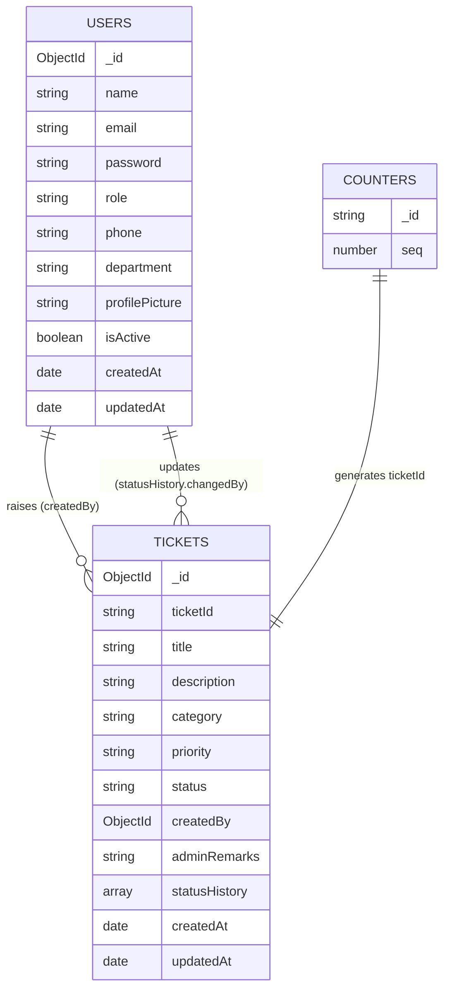

# Database Design
## MongoDB Atlas · Database: `nettech_helpdesk`

Connection string is supplied through the `MONGODB_URI` environment variable (never hard-coded).

## 1. Collections Overview
| Collection | Purpose |
|---|---|
| `users` | Employees and admins |
| `tickets` | Support tickets |
| `counters` | Auto-increment sequence for ticket IDs |

## 2. ER Diagram


## 3. Schemas (Mongoose)

### 3.1 User
```js
const userSchema = new mongoose.Schema({
  name:     { type: String, required: true, trim: true, minlength: 2, maxlength: 50 },
  email:    { type: String, required: true, unique: true, lowercase: true, trim: true },
  password: { type: String, required: true, minlength: 8, select: false },
  role:     { type: String, enum: ['user', 'admin'], default: 'user' },
  phone:    { type: String, trim: true },
  department:     { type: String, trim: true },
  profilePicture: { type: String, default: '' },
  isActive: { type: Boolean, default: true }
}, { timestamps: true });
```

### 3.2 Ticket
```js
const ticketSchema = new mongoose.Schema({
  ticketId:    { type: String, unique: true, index: true },        // NT-0001
  title:       { type: String, required: true, trim: true, minlength: 5, maxlength: 100 },
  description: { type: String, required: true, trim: true, minlength: 10, maxlength: 2000 },
  category:    { type: String, enum: ['Hardware','Software','Network','Account','Other'], default: 'Other' },
  priority:    { type: String, enum: ['Low','Medium','High'], default: 'Medium' },
  status:      { type: String, enum: ['Pending','In Progress','Resolved','Closed'], default: 'Pending' },
  createdBy:   { type: mongoose.Schema.Types.ObjectId, ref: 'User', required: true },
  adminRemarks:{ type: String, default: '' },
  statusHistory: [{
    status:    String,
    remarks:   String,
    changedBy: { type: mongoose.Schema.Types.ObjectId, ref: 'User' },
    changedAt: { type: Date, default: Date.now }
  }]
}, { timestamps: true });
```

### 3.3 Counter
```js
const counterSchema = new mongoose.Schema({
  _id: String,          // e.g. 'ticket'
  seq: { type: Number, default: 0 }
});
```

Ticket ID generator:
```js
const counter = await Counter.findByIdAndUpdate(
  'ticket', { $inc: { seq: 1 } }, { new: true, upsert: true }
);
const ticketId = 'NT-' + String(counter.seq).padStart(4, '0');
```

## 4. Indexes
| Collection | Index | Reason |
|---|---|---|
| users | `{ email: 1 }` unique | Login lookup, uniqueness |
| tickets | `{ ticketId: 1 }` unique | Search by ID |
| tickets | `{ createdBy: 1, createdAt: -1 }` | User's ticket list |
| tickets | `{ status: 1, priority: 1 }` | Admin filters, dashboard |
| tickets | `{ title: 'text', description: 'text' }` | Text search (optional) |

## 5. Relationships
- One user → many tickets (`tickets.createdBy` references `users._id`).
- Status history is **embedded** inside the ticket (always read with it, small size).
- Use `.populate('createdBy', 'name email department')` when admin lists tickets.

## 6. Dashboard Aggregations
```js
// Count by status
Ticket.aggregate([{ $group: { _id: '$status', count: { $sum: 1 } } }]);

// Count by priority
Ticket.aggregate([{ $group: { _id: '$priority', count: { $sum: 1 } } }]);

// Tickets in last 7 days
Ticket.countDocuments({ createdAt: { $gte: new Date(Date.now() - 7*24*60*60*1000) } });
```

## 7. Sample Documents
```json
{
  "_id": "665f1c...",
  "ticketId": "NT-0001",
  "title": "Laptop not connecting to Wi-Fi",
  "description": "Since this morning my laptop cannot connect to office Wi-Fi.",
  "category": "Network",
  "priority": "High",
  "status": "In Progress",
  "createdBy": "665f0a...",
  "adminRemarks": "Technician assigned",
  "statusHistory": [
    { "status": "Pending", "remarks": "Ticket created", "changedAt": "2026-07-24T09:00:00Z" },
    { "status": "In Progress", "remarks": "Technician assigned", "changedAt": "2026-07-24T10:15:00Z" }
  ],
  "createdAt": "2026-07-24T09:00:00Z"
}
```

## 8. Data Rules
- Passwords are never returned (`select: false`) and never logged.
- Deleting a ticket is a hard delete (per brief). For auditing, consider a `deletedAt` soft-delete later.
- Deleting a user (future) should handle or reassign their tickets.
- Admin accounts are only created via the seed script.

## 9. Atlas Setup Checklist
1. Create a free **M0 cluster** at mongodb.com/atlas.
2. **Database Access** → create a database user with a strong password.
3. **Network Access** → add your IP (use `0.0.0.0/0` only for development/testing).
4. **Connect → Drivers** → copy the connection string.
5. Put it in `.env` as `MONGODB_URI`, adding the DB name `nettech_helpdesk` before the `?`.
6. If the password contains special characters (`@ : / ?`), URL-encode them.
